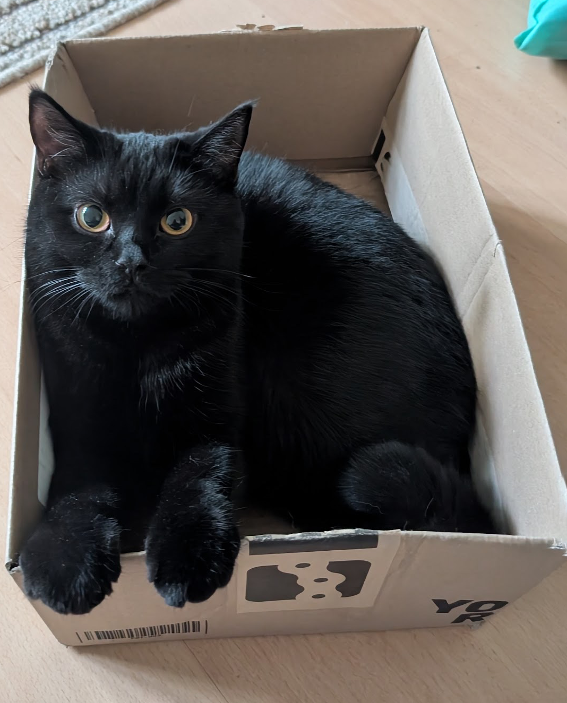
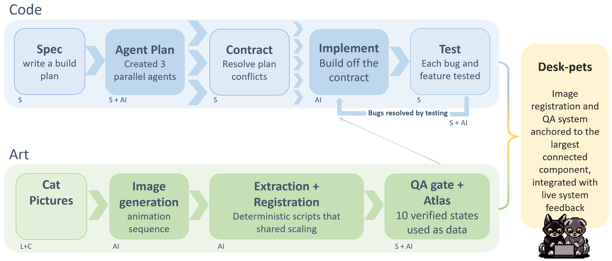

::: {.callout-tip appearance="simple"}
**Want to try it or see how it works?** 

[Install & use it →](https://github.com/Suyash-Naik/DeskPets/releases/download/v0.1.1/DeskPets-Setup-0.1.1.exe) · [Documentation →](https://suyashnaik.com/DeskPets/) · [How it works →](https://suyashnaik.com/DeskPets/internals/how-it-works.html) · [GitHub](https://github.com/Suyash-Naik/DeskPets)
:::

## The Challenge

Clippy never did much for me growing up in the ’90s, but I always liked the idea: a tiny helper living on your desktop. My cats have better uptime than M[364](https://en.wikipedia.org/wiki/2026_Microsoft_outage), collapsing into naps only after an intense bout of zoomies around the house. When I adopted these mischief floofs, it was inevitable that I'd want them close to me everywhere I was. So the idea of giving these two a virtual existence came up: **[DeskPets](https://github.com/Suyash-Naik/DeskPets/releases/download/v0.1.1/DeskPets-Setup-0.1.1.exe)**. The challenge though was making the idea not just cute but also useful.

::: {layout-ncol=2}
{fig-alt="Chico, cuddle bug supreme and mega chomper" .project-image .lightbox group="pets"}

{fig-alt="Layla, sneaky ninja mischief bundle" .project-image .lightbox group="pets"}
:::

**Look at them, how can you not?** 

I am currently exploring hosting different sized LLMs locally and integrating them into different systems that I am developing. Running them in Docker containers on my home setup turned out to be heavy. I wanted to *see* what that load was doing to my machine without opening a bulky monitoring dashboard. That became the first problem DeskPets needed to solve. 

**[DeskPets](https://github.com/Suyash-Naik/DeskPets/releases/download/v0.1.1/DeskPets-Setup-0.1.1.exe)** is now a light, modular, interactive telemetry app where my two **cats tell me how my computer is feeling.**

## What I Built

*Layla & Chico* sit on your desktop and change their behaviour based on your system load.

::: {.stats-strip}
::: {.stat}
[10]{.stat-value} [animation states]{.stat-label}
:::
:::{.stat}
[2]{.stat-value} [parallel pipelines]{.stat-label}
:::
::: {.stat}
[7]{.stat-value} [Plan conflicts resolved]{.stat-label}
:::
::: {.stat}
[5]{.stat-value} [isolated pixi environments]{.stat-label}
:::
:::

{fig-alt="Layla and Chico desktop pets reacting to live system load" .project-image .lightbox}

DeskPets reads CPU, RAM, swap, GPU, battery and idle time, so a calm machine gets a calm cat, sustained high CPU gets a jumping one, and a hot GPU gets a grumpy one. Ten animation states are chosen by a **priority ladder with hysteresis and minimum dwell times rather than a pile of if-statements**. A CPU reading that bounces between 78% and 82% produces one transition instead of four, so the cats don't flicker. 

The app was **built to run next to heavy workloads**, which was the original point: telemetry runs on its own worker thread and shuts down cleanly in about 15 ms, and sprites are decoded with Qt alone. It is also private by design. It detects whether I'm at the keyboard with GetLastInputInfo only, with no keyboard hook. 

Because the sprites were created parallel to the code, **nothing in the code hard-codes the art**. Frame rectangles, counts, durations and loop flags all come from an atlas JSON file, so adding a new animation, or even **your own pet**, is a JSON change plus one config line.

## How I built [DeskPets](https://suyashnaik.com/DeskPets/)

I wrote the spec for this build and then managed the build itself. I wrote the [code and the docs](https://github.com/Suyash-Naik/DeskPets/tree/main) alongside Claude. Codex generated the sprite strips from my prompts and photos of Layla and Chico; my own scripts turned them into frames. Nothing was added until I had tested it.

{fig-alt="DeskPets build pipeline" .project-image .lightbox}

Before any code, [my plan](https://github.com/Suyash-Naik/DeskPets/blob/main/docs/BuildPlan.md) directed three planning agents to design the window, the behaviour, and the stats integrations in parallel. Their plans conflicted in seven places. In one, the animator returned to idle when an animation ended while the telemetry plan held the last frame, so the pet ping-ponged. I settled each conflict in one [contract document](https://github.com/Suyash-Naik/DeskPets/blob/main/docs/PHASE1-CONTRACT.md) that overrode the plans. Then one agent built each module against it, with a rule that it had to run its module on real data before calling it done.

The art ran alongside. Scripts cleaned and aligned the generated frames, a [QA checker](https://github.com/Suyash-Naik/DeskPets/blob/main/tools/frame_qa.py) flagged the bad ones, and I reviewed the motion by eye before everything was packed into a single atlas.

To ship it, I compiled the app with Nuitka (partly because I wanted to learn it) and wrapped it in an Inno Setup installer. The first build was 628 MB, mostly numpy's MKL libraries, which I used in one place. Replacing that with a short pure-Python loop got the folder down to 72 MB and the installer to 22.4 MB. I tested it on a clean Windows 11 VM.

More detail: [how it works](https://suyashnaik.com/DeskPets/internals/how-it-works.html) · [built with agents](https://suyashnaik.com/DeskPets/internals/built-with-agents.html)

### What the Build Log Caught

My first prototype was a sketch of an idea without a concrete plan. I kept a [phase log](https://github.com/Suyash-Naik/DeskPets/blob/main/docs/PHASE1-LOG.md) as we went, and it records what didn't survive contact with the real machine. A few issues surfaced in testing:

- Idle was impossible. My desktop sits at roughly 70% RAM even when idle, so the original 60% threshold meant the pets could never relax.
- High CPU could crash the app. One drawing call used the wrong point type, causing a silent exit with no helpful error message.
- The pets initially froze on screen. A simple frame-counting test caught it before release.
- Click-through needed a Windows-specific fix. Qt’s built-in setting does not work between applications, so I used Windows’ WS_EX_TRANSPARENT window style instead.

I also recorded what I *didn't* solve, such as pixel art that stretches at 1.5× display scaling. The gaps are documented, not hidden.

## A Pomodoro Timer in Six Commits

After using the app for a while, I found that having the cats around kept me engaged while I worked. So I added a Pomodoro timer to organise my work blocks.

Press play on the stats card and a 45-minute focus block starts; the button turns into a stop square while it runs. When time is up, a chime plays and the cats switch to their *pleased* animation for five minutes, a small reward before the next block.

It went from idea to working feature in **six commits, tests included**, within a few minutes, thanks to the **modularity I built in.** The UI, the telemetry and the configuration were already separate, so the timer plugged in without changing much else.

Having a pet that sits with you and keeps track of time as you work makes it easier to stay focused.

## What's Next

There's a lot I want to add to DeskPets. Next up is support for macOS to make it possible for my friends to use it. Then there will be a chat box that uses LLMs. A chat window with tools that are limited to functions. This goes back to where this all began. Learning how to run LLMs. The base part of the code that allows for changing platforms is already there. Only Windows has been set up because of differences, in how the architecture telemetry works. The full roadmap is in the [project plan](https://suyashnaik.com/DeskPets/project/roadmap.html).

::: {.project-links}
[View repository →](https://github.com/Suyash-Naik/DeskPets){.btn-outline}
:::
