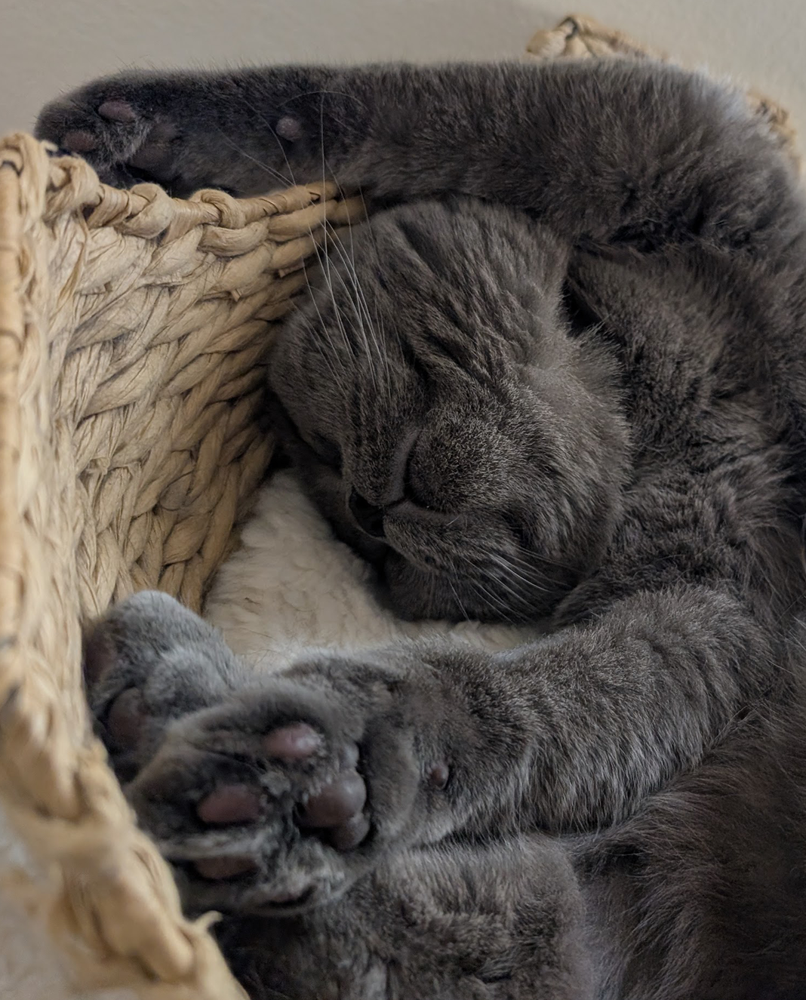
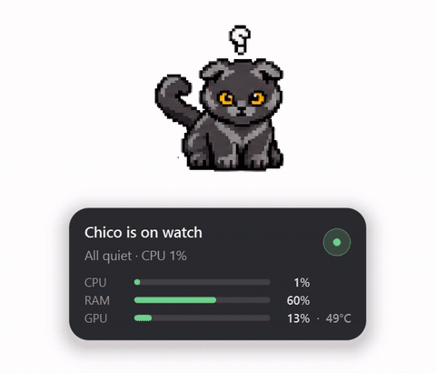

## The Challenge

Growing up the 90s, I didnt really enjoy Clippy (did anyone?), but it did give me the idea of adding my newly adopted mischief floofs directly on my desktop. I wanted to make it so that it was *useful*, not just cute.

I am exploring hosting different sized LLMs locally and integrating them into different systems that I am developing. Running a Docker VM on my home setup turned out to be heavy. I wanted to *see* what that load was doing to my machine without opening a monitoring dashboard.

Around the same time, I had two 8-month-old kittens, Layla and Chico, and I wanted them close while I worked.

::: {layout-ncol=2}
{fig-alt="Chico, cuddle bug supreme and mega chomper" .project-image .lightbox group="pets"}

{fig-alt="Layla, sneaky ninja mischief bundle" .project-image .lightbox group="pets"}
:::

That idea became **DeskPets**: **a light, modular, interactive telemetry app where my two cats tell me how my computer is feeling.**
{fig-alt="Layla and Chico desktop pets reacting to live system load" .project-image .lightbox}

## What I Built

DeskPets (*Layla & Chico*) is a frameless, always-on-top Windows desktop pet. The cats sit on your desktop, change animation with live system load, and show a stats card when you hover over them. I built the first working version in a few days, then tested and improved it as time allowed.

::: {.stats-strip}
::: {.stat}
[10]{.stat-value} [animation states]{.stat-label}
:::
::: {.stat}
[45+]{.stat-value} [commits]{.stat-label}
:::
::: {.stat}
[1.5 s]{.stat-value} [telemetry poll interval]{.stat-label}
:::
::: {.stat}
[0]{.stat-value} [keyboard hooks]{.stat-label}
:::
:::

{fig-alt="Layla and Chico desktop pets reacting to live system load" .project-image .lightbox}

**Telemetry-driven behaviour.** The pets read CPU, RAM, swap, GPU, battery and idle time. A calm machine gets a calm cat. Sustained high CPU gets a jumping cat. A hot GPU gets a grumpy one.

**A state machine, not an if-statement.** Ten animation states are chosen by a priority ladder with hysteresis and minimum dwell times. A CPU reading bouncing between 78% and 82% produces *one* transition, not four, so the cats don't flicker.

**Privacy by design.** The app detects whether I'm at the keyboard with `GetLastInputInfo` only. There is no keyboard hook and no record of what I type.

**Built to run next to heavy workloads.** That was the original point. Telemetry runs on its own worker thread and shuts down cleanly in about 15 ms. Sprites are decoded with Qt alone, and Pillow is deliberately not a runtime dependency.

**Built for changing art.** The sprites were still a work in progress, so nothing in the code hard-codes the art. Frame rectangles, counts, durations and loop flags all come from an atlas JSON file. Adding a new animation is a JSON change plus one config entry.

## What the Build Log Caught

My first prototype was a sketch. I kept a phase log as I went, and it records what didn't survive contact with the real machine:

- **A use-after-free in the sprite loader.** The prototype wrapped a temporary bytes object in a `QImage`. I moved to `QImage(path)` plus `copy(rect)` and dropped Pillow from runtime.
- **An unreachable idle state.** The spec said "idle if CPU < 20% *and* RAM < 60%." I measured my own desktop, and it idles at about 70% RAM, so the idle animation could never trigger. I made idle the unconditional default and demoted RAM to a hint on the card.
- **A hang on quit.** The telemetry thread was a `while True` with no stop flag. I replaced it with a worker driven by a timer.
- **A click-through that couldn't work.** Qt's mouse-transparency flag doesn't work across processes. Only the Windows `WS_EX_TRANSPARENT` style makes the OS skip the window.

I also recorded what I *didn't* solve, such as pixel art that stretches at 1.5× display scaling. The gaps are documented, not hidden.

## The Stress Test: A Pomodoro Timer in Six Commits

After using the app for a while, I found that having the cats around kept me engaged while I worked. So I added a Pomodoro timer to organise my work blocks.

It went from idea to working feature in **six commits, tests included, in a few minutes.** That covered a `PomodoroTimer` class, timer constants in `config.py`, a play button on the stats card, a notification sound, and a button that turns into a stop square while the timer runs.

It only took that long because the app was modular from the start. The UI, the telemetry and the config were separate, so the new feature plugged in without rewriting anything.

## What's Next

- **A first release** alongside this page, so the app is easy to try.
- **Phase 2 (exploratory):** a chat window with scoped tools, which ties back to where this started: learning to run LLMs locally.
- **macOS and Linux.** The platform seam exists in the code, but only Windows is implemented.

::: {.project-links}
[View repository →](https://github.com/Suyash-Naik/DeskPets){.btn-outline}
:::
